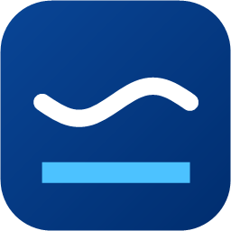
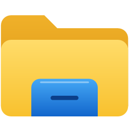
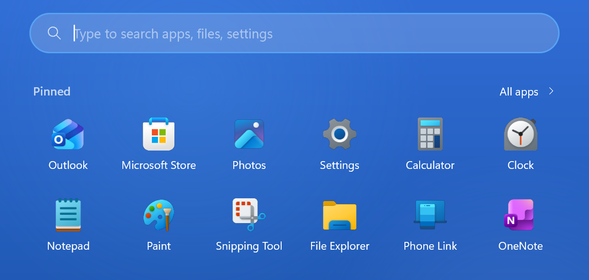
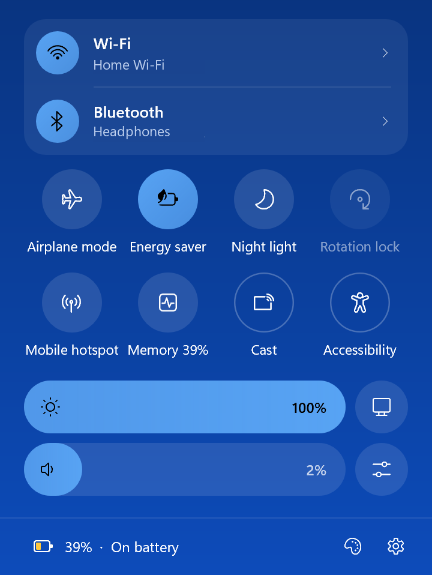
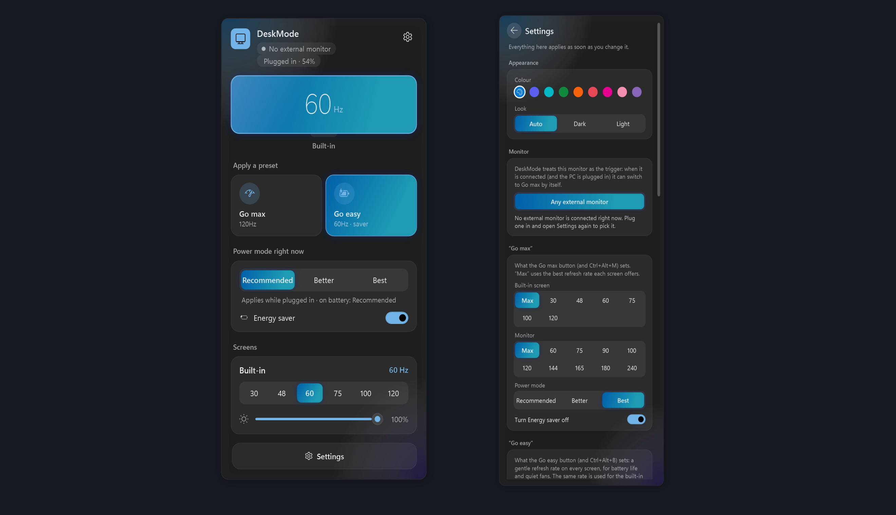
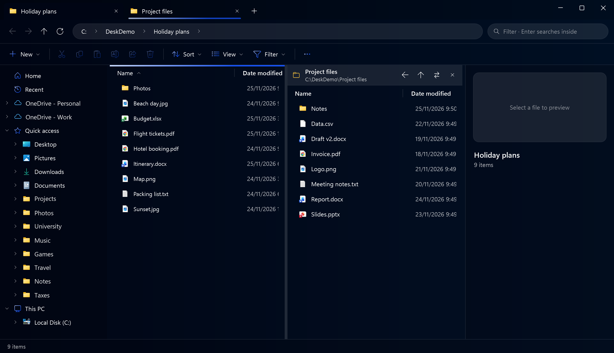
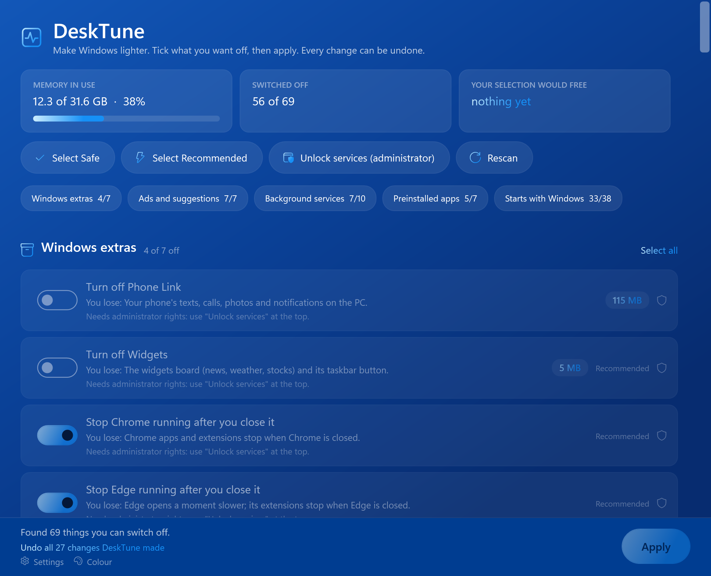

<p align="center">
  
  
  
  
</p>

<h1 align="center">Desk</h1>

<p align="center">
  <b>A lighter Windows desktop.</b><br>
  Three small, free apps that replace the taskbar and File Explorer, switch off what you don't use, and tune your screens.<br>
  No account, no ads, no tracking. Windows 10 and 11, 64-bit.
</p>

<p align="center">
  <a href="https://github.com/sotaras336/desk-suite/actions/workflows/build.yml"></a>
  <a href="https://github.com/sotaras336/desk-suite/releases"></a>
  <a href="LICENSE"></a>
</p>

<p align="center">
  <a href="https://github.com/sotaras336/desk-suite/releases/latest/download/DeskBar-Setup.exe"><b>Download DeskBar</b></a> ·
  <a href="https://github.com/sotaras336/desk-suite/releases/latest/download/DeskDrawer-Setup.exe"><b>Download DeskDrawer</b></a> ·
  <a href="https://github.com/sotaras336/desk-suite/releases/latest/download/DeskTune-Setup.exe"><b>Download DeskTune</b></a> ·
  <a href="https://sotaras336.github.io/desk-suite/">Website</a>
</p>

<p align="center">
  
</p>

## The apps

| App | What it replaces | Size |
|---|---|---|
| [**DeskBar**](#deskbar) | The taskbar, Start and Quick Settings. DeskMode comes inside it. | 1.9 MB |
| [**DeskDrawer**](#deskdrawer) | File Explorer | 1.1 MB |
| [**DeskTune**](#desktune) | Nothing. It switches off what you don't use, and can undo every change. | 0.5 MB |

Use one, two or all three. They work alone or together.

### DeskBar

A taskbar that starts fast, stays out of your way and opens what you search for.

- **Start** with your pinned apps, folders and recent files, and a search that finds any app, setting, file or folder as you type.
- **Quick Settings** for Wi-Fi, Bluetooth, sound, brightness, night light and energy saver. Connect Bluetooth headphones in one tap.
- Window previews, show desktop in the corner, and a clock with a calendar.
- Ten colour themes, including black, white and glass.
- Windows' own taskbar comes back the moment DeskBar quits.

<p align="center">
  
</p>
<p align="center">
  
</p>

### DeskMode (inside DeskBar)

One panel for refresh rate, power mode and brightness. It's the button next to the keyboard language on DeskBar.

- Plug in an external monitor and the charger, and DeskMode switches to your "max" settings by itself. Unplug, and it puts everything back.
- **Go max** and **Go easy** buttons, refresh rate and brightness for each screen (external monitors too, over DDC/CI).
- Leaves screen modes alone while a full-screen game is running. Ctrl+Alt+F makes the front window borderless full screen.
- Shortcuts: Ctrl+Alt+D opens it, Ctrl+Alt+M is Go max, Ctrl+Alt+B is Go easy.

<p align="center">
  
</p>

### DeskDrawer

A file manager with tabs that opens folders as fast as you click them.

- Tabs you can drag, reopen and duplicate. A path bar you can click or type into.
- Search that shows the best matches first and can look through the whole PC.
- Undo for rename, move, copy, new files, and even Delete. ZIP and unzip built in.
- Press **Space** on a file to take a quick look at it without opening it.
- Optional: open your folders and Win+E in DeskDrawer instead of File Explorer, and answer other apps' Open and Save windows. Both are off until you switch them on.

<p align="center">
  
</p>

### DeskTune

A clean-up tool that tells you what each switch costs before you flip it, and can undo every change.

- Startup apps, Widgets, Copilot, background Edge and Chrome, ads and suggestions, telemetry, unused services and preinstalled apps.
- Shows the memory each item uses, and a plain line on what you'd lose.
- Tick what you want, then apply once. **Safe** and **Recommended** presets pick for you.
- Every change is saved and can be undone, one at a time or all together. A restore point is made before system changes.
- It never touches Windows Update, Defender or system files.

<p align="center">
  
</p>

## Install

1. Download the setup file for the app you want from the [latest release](https://github.com/sotaras336/desk-suite/releases/latest): `DeskBar-Setup.exe`, `DeskDrawer-Setup.exe` or `DeskTune-Setup.exe`.
2. Run it. Windows may say **"Windows protected your PC"** because the apps aren't code-signed (certificates cost money every year, and these apps are free). Choose **More info**, then **Run anyway**.
3. That's it. It installs for your account only, without administrator rights, adds a Start menu entry and opens.

**What else you need:** DeskDrawer and DeskTune need Microsoft's free [.NET 10 Desktop Runtime (x64)](https://dotnet.microsoft.com/download/dotnet/10.0). If it's missing, Windows offers to install it the first time you open them. DeskBar needs nothing extra.

**Updates:** each app checks once a day whether a newer version is out. It only installs one when you press **Update now**.

**Want to be sure the file is real?** Compare it with `SHA256SUMS.txt` in the release:

```powershell
Get-FileHash .\DeskBar-Setup.exe -Algorithm SHA256
```

### Uninstall

Open the Start menu and choose **Uninstall DeskBar**, **Uninstall DeskDrawer** or **Uninstall DeskTune**.

- DeskBar gives the taskbar back to Windows.
- DeskDrawer gives folders and Win+E back to File Explorer first.
- DeskTune leaves the changes you made in place. Press **Undo all** in DeskTune first if you want Windows exactly as it was.
- If you installed the separate DeskMode app (up to version 2.5), it has its own **Uninstall DeskMode**. DeskMode is part of DeskBar now.

## Found a bug?

There are two ways to report one:

- **From DeskBar:** turn on **Report a bug** in DeskBar's settings, type what happened and press **Send**. It adds DeskBar's version, your Windows version, your screen setup and the recent logs, so you don't have to look them up. Nothing is sent until you press Send.
- **Using the form:** fill in the [bug report form](FORM_LINK_HERE). Please say which app and version you use, what you did, what you expected and what happened instead. A screenshot helps a lot.

## Privacy

None of the apps have accounts, telemetry or ads, and none of them sends anything about you or your PC.

What they do by themselves:

- About once a day, each app looks at `SHA256SUMS.txt` in this page's newest release to see if there's an update. GitHub sees an ordinary download, nothing more. You can switch this off in each app's settings.
- When Wi-Fi has no internet yet, DeskBar does what Windows does: it asks Microsoft's test address (www.msftconnecttest.com) for a small file, to see whether the network wants you to sign in. That request carries nothing about you.

The only web pages the apps open are ones you click, like a Wi-Fi sign-in page. **Report a bug** in DeskBar is off unless you switch it on, and sends nothing until you press Send.

## What each app changes on your PC

- **DeskBar** hides Windows' taskbar while it runs and brings it back when it quits. Settings are in `%LOCALAPPDATA%\DeskBar3`.
- **DeskMode** (inside DeskBar) changes refresh rates, the power mode and Energy saver only when you press a preset, or by itself when you dock (switch that off in DeskBar's settings, DeskMode page). It remembers what was set before and puts it back when you undock.
- **DeskDrawer** opens your folders and Win+E only if you turn on "Open folders with DeskDrawer". That adds entries under `HKEY_CURRENT_USER\Software\Classes` and removes exactly those when you switch it off. After you close it, it stays ready in the background (about 20–30 MB of memory) and starts hidden when you sign in, so folders open in about half a second. Switch that off with ⋯ > "Keep ready in the background". It answers other apps' Open and Save windows only if you turn on "Use DeskDrawer for other apps' Open and Save windows"; nothing leaves your PC. Settings are in `%LOCALAPPDATA%\DeskDrawer`.
- **DeskTune** changes only what you tick. Each change, and what was there before, is saved in `%LOCALAPPDATA%\DeskTune\changes.json`, so it can be undone even after a restart. It makes a restore point before the first change that needs administrator rights. It never touches Windows Update, Defender, the page file, SysMain or system files.

## Build it yourself

The code is in `src/`. You need Windows.

- **DeskBar** (C++, Win32 and Direct2D): install Visual Studio 2022 or its Build Tools with "Desktop development with C++". Run `src\DeskBar\build.ps1`. The app appears in `src\DeskBar\out`.
- **DeskDrawer** and **DeskTune** (C#, WPF): install the .NET 10 SDK. In `src\DeskDrawer` or `src\DeskTune`, run:

  ```powershell
  dotnet publish -c Release -r win-x64 --self-contained false -p:PublishSingleFile=true -p:DebugType=none -o app
  ```

Each app can check itself: run it with `--selftest report.txt` and read the report. The badge at the top shows whether the latest build and self-tests passed.

A file whose name contains "setup" installs itself to `%LOCALAPPDATA%\Programs\<App>` when you run it. That's how the release files work.

## License

Free and open source under the MIT license. See [LICENSE](LICENSE).

Desk is made by one person, for their own desk, and shared for free.
